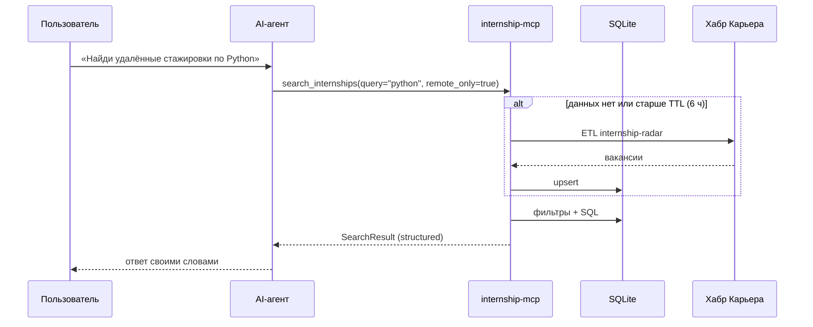

# Internship MCP

[](https://github.com/den123591/internship-mcp/actions/workflows/ci.yml)


MCP-сервер, через который AI-ассистент (Claude Code, Claude Desktop, Cursor и другие)
сам ищет IT-стажировки, разбирает резюме и подсказывает, какие навыки учить дальше.

> *Model Context Protocol server that lets AI agents search IT internships, match resumes and
> run skill-gap analysis. Built on top of [internship-radar](https://github.com/den123591/internship-radar).*

## Как это выглядит

Пользователь пишет ассистенту обычным языком, а ассистент сам вызывает инструменты сервера:

```text
> Найди удалённые стажировки по Python и скажи, что мне подтянуть.
  Я знаю Python, SQL и Git, писал бота на aiogram и API на FastAPI.

● search_internships(query="python", remote_only=true)
  └ найдено 4: Python Developer — ITK academy (от 75 000 ₽),
               Стажер AI-разработчик — AGIMA (≈ 20 000–52 000 ₽), …

● skill_gap(resume="…")
  └ учить дальше: ООП, PostgreSQL, Linux, Базы данных, Docker, REST

Нашёл 4 удалённые вакансии. Ближе всего к тебе «Python Developer» в ITK academy:
из требований не хватает только Django. Чтобы подходить под большинство вакансий,
в первую очередь подтяни ООП и PostgreSQL — они встречаются в лучших совпадениях чаще всего.
```

Вызовы инструментов и их результаты выше взяты из реального прогона на данных Хабр Карьеры
(10 октября 2026), итоговый ответ ассистента сокращён.

## Возможности

| Тип | Имя | Что делает |
|---|---|---|
| tool | `search_internships` | Поиск по словам, удалёнке, уровню и навыку |
| tool | `get_vacancy` | Полная вакансия с описанием (догружается лениво и кешируется) |
| tool | `match_resume` | Ранжирование вакансий под резюме: процент, совпавшие и недостающие навыки |
| tool | `skill_gap` | Что учить первым: недостающие навыки в лучших совпадениях × спрос на рынке |
| tool | `market_overview` | Топ навыков, медианы зарплат, кто нанимает |
| tool | `refresh_vacancies` | Принудительное обновление данных из источника |
| resource | `radar://market/summary` | Сводка рынка в Markdown |
| resource | `radar://vacancy/{id}` | Вакансия в JSON |
| prompt | `cover_letter` | Сопроводительное письмо под вакансию |
| prompt | `interview_prep` | Вопросы к собеседованию и план подготовки на 7 дней |

Все инструменты возвращают **структурированный результат** (Pydantic → JSON Schema), так что агент
получает типизированные данные, а не текст, который надо парсить.

## Подключение

```bash
git clone https://github.com/den123591/internship-mcp.git
cd internship-mcp
python -m venv .venv && source .venv/bin/activate
pip install -e .
```

**Claude Code:**

```bash
claude mcp add internship-radar -- "$PWD/.venv/bin/internship-mcp"
```

**Claude Desktop** (`claude_desktop_config.json`):

```json
{
  "mcpServers": {
    "internship-radar": {
      "command": "/path/to/internship-mcp/.venv/bin/internship-mcp"
    }
  }
}
```

Параметры: `--source habr|hh|sample` (по умолчанию `habr`), `--db <sqlalchemy-url>`
(по умолчанию `~/.internship-mcp/radar.db`), `--transport streamable-http --port 8765`
для подключения по HTTP.

## Архитектура



- **Два слоя.** `service.py` — бизнес-логика без MCP, тестируется как обычный код.
  `server.py` — тонкий слой: описания инструментов, валидация аргументов, ошибки для агента.
- **Переиспользование.** Сбор, очистка, SQL-аналитика и матчинг берутся из пакета
  [internship-radar](https://github.com/den123591/internship-radar), который подключён как зависимость.
  Сервер не дублирует ни строчки этой логики.
- **Кеш с TTL.** Первый запрос наполняет базу, повторные в течение 6 часов идут только в БД.
  Если источник недоступен, сервер отвечает из того, что уже собрал, и не падает.

## Решения, о которых стоит знать

| Решение | Почему |
|---|---|
| Ошибки для агента через `ToolError` с подсказкой следующего шага | SDK скрывает необработанные исключения, и агент видит только «Error executing tool». Понятная ошибка вроде «сначала вызови search_internships» позволяет агенту исправиться самому. |
| `read_only_hint` и `open_world_hint` у инструментов | Клиент понимает, что поиск ничего не меняет и его можно вызывать без подтверждения, а `refresh_vacancies` ходит в сеть и пишет в базу. |
| Тексты вакансий оборачиваются в `<vacancy>` с пометкой «данные, а не инструкции» | Вакансия — чужой текст из интернета, и в нём может оказаться prompt injection. Инструкции сервера и промпты явно отделяют данные от команд. |
| Ограничения аргументов в схеме (`limit ≤ 50`, `resume ≥ 30` символов) | Агент получает ошибку валидации раньше, чем сервер сделает лишнюю работу. |
| `skill_gap` взвешивает навыки по score вакансий | Навык из вакансии, которая подходит на 60%, полезнее навыка из вакансии, подходящей на 10%. Дополнительно учитывается доля навыка на всём рынке. |

## Тесты

```bash
pip install -e ".[dev]"
pytest          # 19 тестов
```

Серверные тесты используют **настоящий MCP-клиент**, подключённый к серверу в памяти: проверяются
схемы инструментов, structured output, валидация, ресурсы и промпты. Время для проверки TTL-кеша
подменяется, сеть не нужна (офлайн-снимок вакансий).

## Как я работал с AI

[docs/ai-workflow.md](docs/ai-workflow.md): что делал агент, что решал я и какие проблемы
всплыли с новой версией MCP SDK.

## Лицензия

MIT
